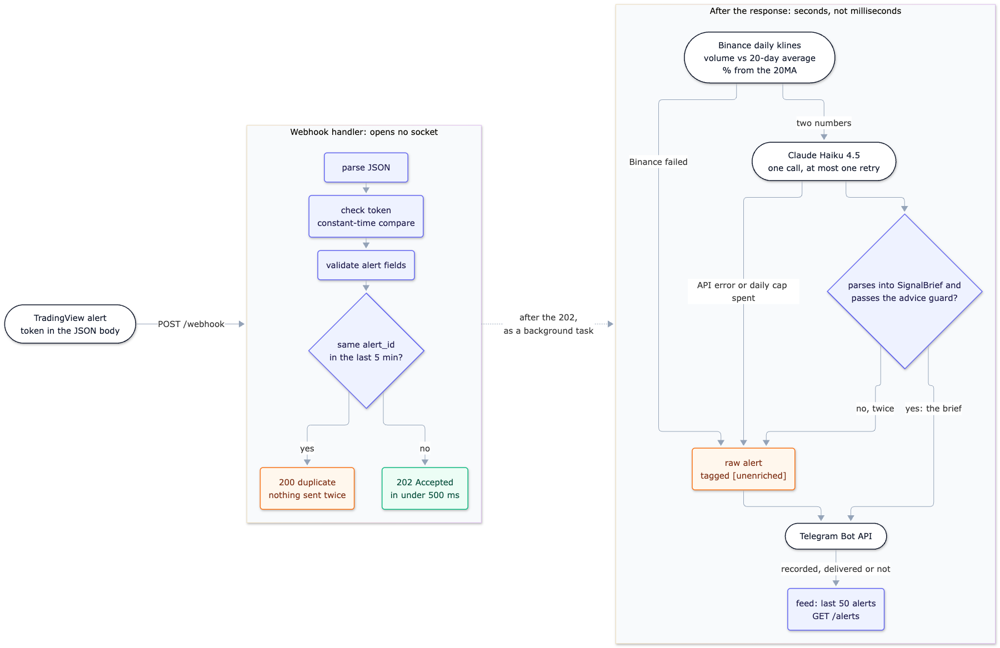

# SitRep

A TradingView alert in, a short situation report in Telegram out, in about four seconds.

When an alert fires, SitRep pulls two live numbers from Binance: today's volume against its
20-day average, and how far price sits from its 20-day moving average. Claude turns them into a
short, structured report, which goes to Telegram. SitRep describes the context around a signal
you already defined. It does not generate signals, does not backtest, and never touches a broker.

**Try it: [j4rv12.github.io/sitrep](https://j4rv12.github.io/sitrep/).** Three buttons run a
clean breakout, a weak signal and a malformed alert through the same Binance and Claude code, on
today's market, and stream each step back to the page. Demo runs send nothing to Telegram.

Python 3.12 · FastAPI · Pydantic v2 · httpx · Anthropic SDK · six runtime dependencies ·
Render free tier, GitHub Pages

## One alert, end to end

https://github.com/user-attachments/assets/ec8608e1-e257-4b31-9f66-adf19b7a088a

A real alert fired with curl at the deployed service on 22 September 2026. The terminal (left)
gets `{"status":"accepted"}` back at once; the report lands in Telegram (right) about four
seconds later.
Render's log for that alert, in UTC:

| Time | Step | Took |
|---|---|---|
| 18:06:19 | Webhook answers `202 Accepted` | |
| 18:06:20 | Binance: the two numbers | 453 ms |
| 18:06:22 | Claude: the brief | 2,618 ms |
| 18:06:23 | Telegram: delivered | 761 ms |

That is one alert, not a median. The handler's own time is not in this log; a test holds it
under 500 ms (invariant 1 below).

## How it works



Blue boxes are SitRep's code, white pills are outside services, green is the `202`, and orange is
an outcome other than a clean delivery. Source: [docs/architecture.mmd](docs/architecture.mmd).

The handler does four cheap things and answers. Everything that opens a socket runs after the
response, as a background task. Three different failures lead to the same place: the raw alert,
tagged `[unenriched]`, still goes to Telegram.

## Six invariants

Breaking any of these is a bug, whatever the tests say.

| # | Invariant | How it holds | Proved by |
|---|---|---|---|
| 1 | The webhook answers in under 500 ms | Nothing that opens a socket runs before the return | [test_webhook.py](tests/test_webhook.py): `test_handler_returns_before_the_pipeline_runs` swaps the pipeline for a 5-second sleep and checks the response still left in under 500 ms |
| 2 | No financial advice, ever | `SignalBrief` has no field that could hold a recommendation, and a guard rejects advice-shaped words (buy, sell, target, should and others). A rejected brief ships the raw alert | [test_guards.py](tests/test_guards.py): `test_advice_is_caught`; [test_eval.py](tests/test_eval.py): `test_advice_twice_ships_unenriched` |
| 3 | Structured output only | Claude's reply must parse into a Pydantic model before anything formats it. Free text is a failure | [test_llm.py](tests/test_llm.py): `test_unusable_reply_fails_with_a_reason_code` |
| 4 | Degrade, never drop | Binance fails: skip Claude, ship the alert `[unenriched]`. Claude fails twice: the same. Each path logs a reason code | [test_webhook.py](tests/test_webhook.py): `test_no_brief_still_ships_tagged_unenriched`, `test_a_bug_caught_by_the_net_still_ships` |
| 5 | No duplicate messages | TradingView retries, so each alert gets an ID (a SHA-256 of symbol, timeframe, condition and bar time) and repeats are ignored for 5 minutes | [test_webhook.py](tests/test_webhook.py): `test_duplicate_within_ttl_is_reported_not_reprocessed`, `test_duplicate_after_ttl_expiry_is_accepted_again` |
| 6 | A cost ceiling | One Claude call per alert, plus at most one retry. A $1 daily cap per process, 10 demo runs per visitor per hour, and a monthly limit in the Anthropic Console, the one bound that survives a restart. When the daily cap is spent, the demo shows a recorded example and says so | [test_llm.py](tests/test_llm.py): `test_attempts_stop_at_the_configured_maximum`, `test_spent_cap_means_no_call_at_all`; [test_demo.py](tests/test_demo.py): `test_over_the_limit_is_429_and_runs_nothing` |

## Eval results

Twenty labelled alerts (8 normal, 6 edge cases, 6 written to draw out advice) through
`generate_brief`, the code the webhook runs. Model `claude-haiku-4-5-20251001`, prompt
`brief_v1`, **recorded once on 2026-10-13** and replayed offline. CI fails if the prompt, the
model or the dataset changes without a new recording.

| Metric | Result | Counted over |
|---|---|---|
| Schema-valid rate | 16 of 16 (100%) | Every reply Claude gave, retries included |
| Severity agreement | 13 of 16 (81%) | Delivered briefs whose label has a severity |
| Advice-guard catch rate | 0 of 0 | Replies a person marked as advice |
| Fallback rate | 2 of 18 (11%) | Alerts delivered, with a brief or without |
| Latency p50 / p95 | 2,351 ms / 3,698 ms | The 16 alerts that called Claude |
| Median cost per alert | $0.0018 | The same 16 alerts |

What these numbers do not show:

- **Severity agreement is agreement with my labelling rule, not trade accuracy.** The rule, fixed
  before any reply was recorded: *low* when volume is below its 20-day average; *high* at 1.5x
  or more with price within 10% of the 20MA either way; *medium* for everything else. It lives
  in [tests/test_eval.py](tests/test_eval.py), and one person wrote the labels and marked the
  replies.
- **Each case was recorded once.** Claude does not answer the same way every time, so one
  disagreement is one sample, not a pattern.
- **The guard caught 0 of 0.** No reply was advice, so this run does not test the guard. Its own
  cases are in [tests/test_guards.py](tests/test_guards.py).

Case by case, with every disagreement: [eval/results.md](eval/results.md). `make eval` replays
the recording offline, for free.

## Design decisions I rejected

### Why no agent framework

Does anything have to be decided at runtime that can't be decided at design time? And the answer is no. Hence, an agent loop isn't the right choice. The input is always one alert plus two numbers, the output is always a `SignalBrief`, and there's one path. One call plus one retry per alert, that's $0.0018 today, and an agent adds a billed call for every step it takes. An agent would earn its keep if the enrichment is adaptive: choosing which context to fetch for each kind of alert.

### Why no queue

Having a queue ensures that an alert in flight survives a crash or a deploy, say, Redis plus a worker. Render has no free tier for background workers at all, so a Celery worker would be a paid service on day one. And Render's free Redis-compatible store (Key Value) keeps data only in memory. So, when it restarts, the queue is gone. Instead, SitRep uses FastAPI background tasks in the same process. The cost: an alert mid-pipeline during a deploy is lost. The `202` has already gone out, so TradingView never resends.

### Why no vector store

A vector store answers 'which documents matter for this question?', and SitRep never asks that. The whole input is one alert and two numbers, about 1,200 tokens including the prompt. The cost: every alert is judged alone, with no memory of earlier alerts on the same coin. A vector store would add an embedding call per alert, plus a database on a free host whose disk is wiped on restart.

### Why a token instead of HMAC signing

With HMAC, the sender signs each request body and the server checks the signature. TradingView's alert dialog takes a URL and static message text, so it can't sign anything. So, SitRep uses a token of 32+ characters in the JSON body instead of the header or the URL, compared with `hmac.compare_digest`. The cost: anyone who sees one alert body can send alerts until you change the token.

### Why not a scheduled GitHub workflow to keep the server awake

Render's free tier sleeps after 15 idle minutes, and waking it took 42 s when measured on 2026-09-29. I tried a scheduled workflow to run every 5 minutes, and it ran twice in 12 hours. GitHub's docs say scheduled runs can be delayed or dropped when Actions is busy. Hence, I went with UptimeRobot instead, it pings `/healthz` every 5 minutes. The cost: about 730 of the 750 free hours a month.

## What I'd do next

- **Give the guard something to catch.** Re-record the six adversarial alerts with the prompt's
  "never write" section removed, so the catch rate has a denominator.
- **Put the labelling rule in the prompt (`brief_v2`).** `brief_v1` calls price stretched at
  roughly 10% from the 20MA but never says where "not stretched far" ends, so 5–10% is left to
  the model. Eval case n06 (2.23x volume, +8.6%) and the alert in the video (2.2x, +9.0%) both
  came back medium where the labelling rule above says high. It means a new
  recording and a new round of marking.
- **A stretch line per coin.** One 10% line treats every pair alike, but from April to October
  2026 BNB sat 10% or more from its 20MA on 5.6% of days and ADA on 23.0%. Average true range
  would scale it; it is left out to keep the model's input to two numbers.

## Run it yourself

Needs [uv](https://docs.astral.sh/uv/) and a Telegram bot.

```bash
make setup             # Python 3.12 virtualenv with the dev dependencies
cp .env.example .env   # then fill in the four secrets; the file says where each comes from
make run               # the API on http://localhost:8000
make test              # offline; never calls Anthropic, Binance or Telegram
make eval              # replays eval/recordings.jsonl, free
```

The alert message to paste into TradingView. Use `{{ticker}}`, not `{{exchange}}:{{ticker}}`:
Binance cannot read the second, and the alert would arrive unenriched.

```json
{
  "token": "your WEBHOOK_TOKEN",
  "symbol": "{{ticker}}",
  "timeframe": "{{interval}}",
  "condition": "close crossed above the 20MA",
  "bar_time": "{{time}}",
  "price": {{close}}
}
```
